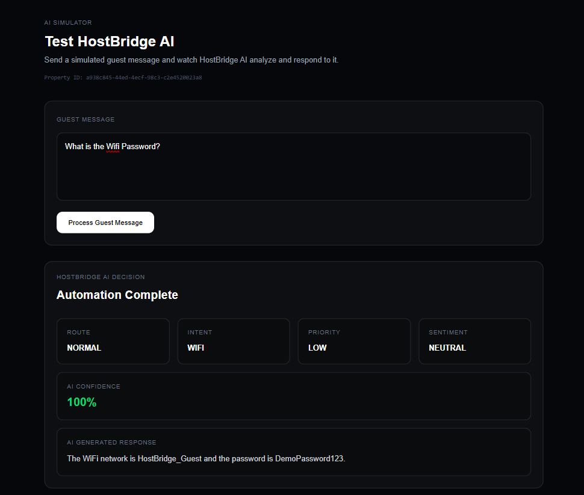
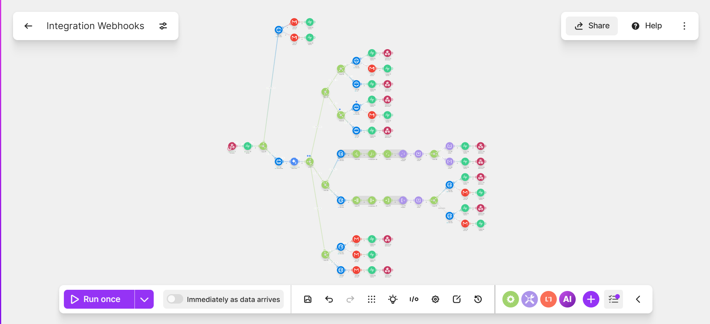

# HostBridge AI

AI-powered guest communication automation system for Airbnb and short-term rental operations.

HostBridge AI is an intelligent automation platform that uses AI classification, workflow automation, and property data integration to help hosts manage guest conversations faster and more efficiently.

The system analyzes incoming guest messages, understands their intent, routes them to the correct workflow, generates appropriate responses, and escalates critical issues when human intervention is required.

---

# Overview

Managing guest communication manually is repetitive and time-consuming.

HostBridge AI acts as an AI assistant that can:

- Understand guest messages
- Classify guest intent
- Detect urgency and sentiment
- Route conversations automatically
- Answer routine property questions
- Handle availability requests
- Process reservation inquiries
- Escalate important issues
- Store conversation history and analytics

The goal is to reduce response time, improve guest experience, and automate repetitive hosting operations.

---

# System Workflow

```
Guest Message
      |
      v
HostBridge AI
      |
      v
AI Intent Classification
      |
      v
Route Decision
      |
      +-------------------------+
      |                         |
      v                         v
Normal Requests             Escalations
      |                         |
      v                         v
Automated Response        Host Notification
      |
      v
Conversation Logging
```

---

# Features

## AI Message Classification

Every incoming guest message is analyzed by AI and classified based on:

- Intent
- Priority
- Sentiment
- Confidence score
- Required workflow route

Supported intent categories:

- Inquiry
- Reservation
- Availability
- Escalation

---

# Automated Inquiry Handling

HostBridge AI handles common guest questions automatically.

Examples:

- WiFi information
- Check-in instructions
- Checkout information
- Parking details
- House rules
- Nearby recommendations
- Property information

Responses are generated using verified property data.

---

# Availability Workflow

Availability requests are automatically identified.

Example:

> Is this property available for my dates?

The workflow:

1. Detects availability intent
2. Extracts requested dates
3. Routes the request to availability processing
4. Checks availability logic
5. Returns a guest-facing response

---

# Reservation Workflow

Handles booking-related conversations.

Examples:

- Booking requests
- Reservation assistance
- Guest booking questions
- Reservation-related inquiries

---

# Escalation System

HostBridge AI identifies situations that require human attention.

Examples:

- Safety concerns
- Lockouts
- Property damage
- Emergency situations
- Serious complaints
- Security issues

Instead of generating unsafe automated responses, the system creates an escalation path.

---

# Architecture

```
                    Guest
                      |
                      v
              HostBridge Simulator
                      |
                      v
              Next.js API Route
                      |
                      v
              Gemini AI Engine
                      |
                      v
              Automation Router
                      |
        +-------------+-------------+
        |             |             |
        v             v             v
    Inquiry     Availability   Escalation
        |             |             |
        v             v             v
 Property Data   Calendar Logic   Alerts
        |
        v
 Supabase Database
```

---

# Technology Stack

## Frontend

- Next.js
- React
- Tailwind CSS

## Backend

- Next.js API Routes
- Supabase

## Artificial Intelligence

- Google Gemini API

## Automation

- Make.com

## Database

- Supabase PostgreSQL

---

# Database & Logging

HostBridge AI stores conversation data including:

- Guest message
- AI response
- Intent
- Route
- Priority
- Sentiment
- Confidence score
- Conversation status
- Response time

This allows monitoring and future analytics.

---

# Workflow Screenshots

Add workflow screenshots inside:

```
screenshots/
```

Example:

```
screenshots/
│
├── dashboard.png
├── make-workflow.png
└── availability-flow.png
```

Then display them here:

## AI Decision Dashboard




## Automation Workflow




## Availability Workflow


---

# Local Installation

## Clone Repository

```bash
git clone https://github.com/Maaz5711/HostBridge-AI.git

cd HostBridge-AI
```

---

## Install Dependencies

```bash
npm install
```

---

## Environment Variables

Create:

```
.env.local
```

Add:

```
NEXT_PUBLIC_SUPABASE_URL=

SUPABASE_SERVICE_ROLE_KEY=

GEMINI_API_KEY=
```

---

## Run Application

```bash
npm run dev
```

Open:

```
http://localhost:3000
```

---

# Current Project Status

Completed workflows:

✅ AI message classification  
✅ Inquiry automation  
✅ Reservation workflow  
✅ Availability workflow  
✅ Escalation workflow  
✅ Supabase conversation logging  
✅ Frontend AI decision dashboard  
✅ Automated routing system  

---

# Future Improvements

Planned improvements:

- Live Airbnb API integration
- Real-time calendar synchronization
- Multi-property management dashboard
- Automated review requests
- Guest history memory
- Advanced analytics
- SaaS multi-tenant architecture

---

# Author

## Maaz Ahmed

GitHub:

https://github.com/Maaz5711

LinkedIn:

https://linkedin.com/in/maazahmed369