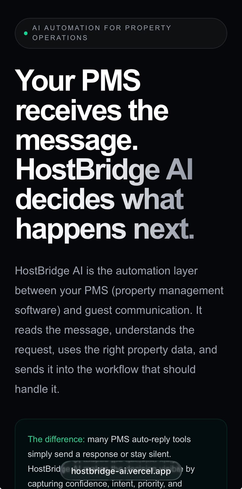
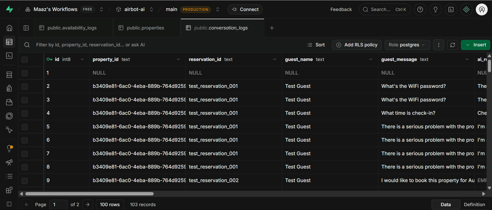

<div align="center">

# 🏡 HostBridge AI

### AI-Powered Guest Communication Automation for Airbnb & Short-Term Rentals

Intelligent AI routing, workflow automation, and property management built with Next.js, Gemini AI, Supabase, and Make.com.


</div>

---

## Overview

Managing guest communication manually is repetitive and time-consuming. HostBridge AI is an intelligent automation platform that uses AI classification, workflow automation, and property data integration to help hosts manage guest conversations faster and more efficiently.

The system analyzes incoming guest messages, understands their intent, routes them to the correct workflow, generates appropriate responses using verified property data, and escalates critical issues when human intervention is required.

> **Note:** Airbnb connectivity is currently demonstrated through workflow automation (Make.com + PMS webhook integration) rather than a direct Airbnb API connection, since Airbnb does not offer public API access to individual developers. The interactive demo on this site simulates the guest-message side of that pipeline so the automation engine can be explored without a live account.

### Key Highlights

- 🧠 **AI-driven classification** — every message is scored for intent, priority, sentiment, and confidence before any action is taken
- 🛡️ **Confidence-gated escalation** — messages below a 75% confidence threshold are routed to a human automatically, regardless of classification
- 🏠 **Property-aware responses** — replies are generated only from that property's verified data, never invented
- 📊 **Full conversation logging** — every message, decision, and outcome is stored in Supabase for review
- 🔌 **PMS-agnostic design** — built on generic webhook/HTTP modules so it isn't locked to a single property management platform

---

## Screenshots

### Homepage



### AI Decision Dashboard


### Automation Workflow


### Conversation Logs



---

## Features

### AI Message Classification

Every incoming guest message is analyzed by AI and classified based on:

- Intent
- Priority
- Sentiment
- Confidence score
- Required workflow route

Supported intent categories:

- Inquiry
- Reservation
- Availability
- Escalation

### Automated Inquiry Handling

HostBridge AI handles common guest questions automatically, using verified property data:

- WiFi information
- Check-in instructions
- Checkout information
- Parking details
- House rules
- Nearby recommendations
- Property information

### Availability Workflow

Availability requests are automatically identified and processed.

> Example: *"Is this property available for my dates?"*

1. Detects availability intent
2. Extracts requested dates
3. Routes the request to availability processing
4. Checks availability logic
5. Returns a guest-facing response

### Reservation Workflow

Handles booking-related conversations, including booking requests, reservation assistance, and guest booking questions.

### Escalation System

HostBridge AI identifies situations that require human attention rather than generating unsafe automated responses:

- Safety concerns
- Lockouts
- Property damage
- Emergency situations
- Serious complaints
- Security issues

---

## Architecture

```
                    Guest
                      |
                      v
              HostBridge Simulator
                      |
                      v
              Next.js API Route
                      |
                      v
              Gemini AI Engine
                      |
                      v
              Automation Router
                      |
        +-------------+-------------+
        |             |             |
        v             v             v
    Inquiry     Availability   Escalation
        |             |             |
        v             v             v
 Property Data   Calendar Logic   Alerts
        |
        v
 Supabase Database
```

---

## Tech Stack

| Category | Technologies |
|----------|--------------|
| Frontend | Next.js, React, Tailwind CSS |
| Backend | Next.js API Routes |
| AI | Google Gemini API |
| Automation | Make.com |
| Database | Supabase PostgreSQL |

---

## System Workflow

```
Guest Message
      |
      v
HostBridge AI
      |
      v
AI Intent Classification
      |
      v
Route Decision
      |
      +-------------------------+
      |                         |
      v                         v
Normal Requests             Escalations
      |                         |
      v                         v
Automated Response        Host Notification
      |
      v
Conversation Logging
```

---

## Local Installation

### Clone Repository

```bash
git clone https://github.com/Maaz5711/HostBridge-AI.git
cd HostBridge-AI
```

### Install Dependencies

```bash
npm install
```

### Environment Variables

Create a `.env.local` file:

```
NEXT_PUBLIC_SUPABASE_URL=
SUPABASE_SERVICE_ROLE_KEY=
GEMINI_API_KEY=
```

### Run Application

```bash
npm run dev
```

Open [http://localhost:3000](http://localhost:3000)

---

## Project Structure

```
HostBridge-AI/
│
├── app/
│   ├── page.tsx                     # Landing page
│   ├── setup/                       # Demo property setup
│   ├── api/
│   │   └── demo/route.ts            # Simulated AI decision endpoint
│   └── workspace/
│       └── [propertyId]/
│           ├── layout.tsx           # Workspace shell + sidebar
│           ├── page.tsx             # Overview dashboard
│           ├── simulator/           # AI Simulator
│           ├── inbox/               # AI Inbox (conversation log)
│           └── availability/        # Availability records
│
├── components/
│   └── workspace/
│       └── Sidebar.tsx
│
├── lib/
│   └── supabase/
│       └── client.ts
│
├── screenshots/
└── .env.local
```

---

## Current Project Status

Completed workflows:

- ✅ AI message classification
- ✅ Inquiry automation
- ✅ Reservation workflow
- ✅ Availability workflow
- ✅ Escalation workflow
- ✅ Supabase conversation logging
- ✅ Frontend AI decision dashboard
- ✅ Automated routing system

---

## Roadmap

- [ ] Live PMS/Airbnb channel integration for self-serve accounts
- [ ] Real-time calendar synchronization
- [ ] Multi-property management dashboard
- [ ] Automated review requests
- [ ] Guest history memory across stays
- [ ] Advanced analytics (resolution rate, response time trends)
- [ ] SaaS multi-tenant architecture with account connections

---

## Author

**Maaz Ahmed**

- GitHub: [@Maaz5711](https://github.com/Maaz5711)
- LinkedIn: [Maaz Ahmed](https://linkedin.com/in/maazahmed369)